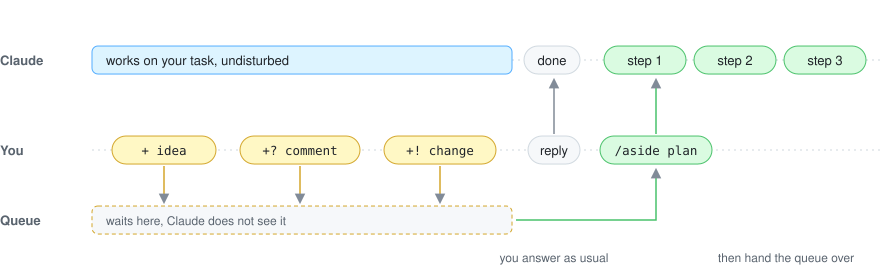

# aside

A prompt queue for Claude Code. Note ideas and comments while Claude works, without interrupting it, and hand them over when you are ready.

<p>
  <a href="https://github.com/gravityXX/aside/actions/workflows/ci.yml"></a>
  
  <a href="LICENSE"></a>
</p>

<picture>
  <source media="(prefers-color-scheme: dark)" srcset="assets/how-it-works-dark.svg">
  
</picture>

Want to queue prompts without interrupting Claude, or send something only after it finishes? That is what aside is for.

## How it works

### 1. Note it while Claude works

Start a message with `+`: it goes to the queue, not to Claude. To comment on something, copy it first, from anywhere. No paste: aside reads the clipboard.

```text
> + cache the parsed config     idea
> +! make it a table            change
> +- not needed here            drop
> ++ compare with 2024          dig deeper
> +? where is this from         question
  queued ? docs/report.md:42 "Revenue grew by 12% in Q3." (5 waiting)
```

### 2. Answer Claude as usual

Your reply goes to Claude. By default the queue just waits, in a line above the prompt.

```text
Claude: Shall I update the docs too?
queue: 1 idea, 4 comments · organize
> yes, go ahead
```

### 3. Plan or run when ready

Nothing reaches Claude until you say so: look at the list, then plan, run or pop.

```text
> /aside          see the list
> /aside plan     Claude turns it into steps
> /aside run      run them
> /aside pop 2    or take one entry into the prompt box
```

## Install

```text
/plugin marketplace add gravityXX/aside
/plugin install aside@aside
```

Requires Claude Code 2.1.301 or newer. The plugin API aside builds on is in early access and may change between releases.

## Commands

<table>
  <tr>
    <th colspan="2">Queue</th>
    <th colspan="2">Entries</th>
  </tr>
  <tr>
    <td><code>/aside</code></td><td>Show the queue and the plan</td>
    <td><code>/aside pop [N]</code></td><td>Put the last one (or N) in the box</td>
  </tr>
  <tr>
    <td><code>/aside plan</code></td><td>Turn the queue into steps</td>
    <td><code>/aside edit N</code></td><td>Rework one and queue it again</td>
  </tr>
  <tr>
    <td><code>/aside run [N]</code></td><td>Run the steps, or step N</td>
    <td><code>/aside remove N</code></td><td>Remove one</td>
  </tr>
  <tr>
    <td><code>/aside run all</code></td><td>Send the queue as is, no plan</td>
    <td><code>/aside clear</code></td><td>Empty the queue</td>
  </tr>
  <tr>
    <td><code>/aside stop</code></td><td>Stop after the current step</td>
    <td><code>/aside undo</code></td><td>Bring back what plan, run or clear took</td>
  </tr>
</table>

`/aside help` lists every command; Tab completes them.

<details>
<summary>Other ways to comment</summary>

<br>

**Copy from anywhere.** VS Code, a terminal, a markdown preview, a web page, a PDF: whatever lands on the clipboard counts. Text found in a markdown file of the project (five words or more) is pinned to its line. Anything else is kept as a quote.

**Name the place yourself,** right after the mark:

```text
+? @docs/report.md:42 why this order
+! @report.md#results shorter
+- #appendix
```

**Select instead of copying.** On Claude's own reply in the terminal (fullscreen mode), select the lines with the mouse.

**Ask about a failure.** With nothing copied or selected, a comment carries the last tool output of the turn, an error first, so `+? why did this fail` arrives with its error.

**Leave tags in a file.** In markdown files Claude wrote or edited this session, these count as comments too. `/aside scan FILE` adds any other file.

```markdown
<!-- ? question -->
<!-- ! change -->
<!-- - drop -->
<!-- + dig deeper -->
```

</details>

<details>
<summary>Settings, platforms and privacy</summary>

<br>

**One setting.** `/config` has `whenTurnEnds`: what happens to the queue when Claude finishes a turn. `wait` (default) keeps it until you run `/aside plan` or `/aside run`, `plan` turns it into a plan at once, `send` sends it to be done at once. Neither hands it over while a saved plan still has steps to do.

**Clipboard.** Read with `powershell.exe` on WSL, `pbpaste` on macOS, `wl-paste`, `xclip` or `xsel` on Linux and `powershell` on Windows. Only for a comment that names no line or heading, never for a plain `+` idea.

**Privacy.** The queue stays on your machine, one per project. Nothing reaches Claude until you run `/aside plan` or `/aside run`, or `whenTurnEnds` hands it over.

</details>

<br>

<p><sub><a href="LICENSE">LICENSE</a> &#xB7; <a href="CHANGELOG.md">CHANGELOG</a> &#xB7; <a href="CONTRIBUTING.md">CONTRIBUTING</a></sub></p>
