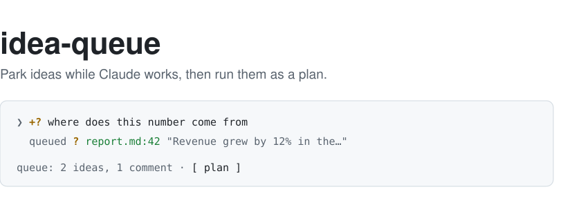

<picture>
  <source media="(prefers-color-scheme: dark)" srcset="assets/banner-dark.svg">
  
</picture>

<p>
  <a href="https://github.com/gravityXX/idea-queue/actions/workflows/ci.yml"></a>
  
  
  
</p>

Ideas keep coming while Claude works. Park them without interrupting it, then run them as a plan.

```text
+ add a dark mode toggle                 queued; Claude keeps working
+? where does this number come from      a question about the text you just copied
/queue plan                              Claude turns the queue into steps
/queue run                               the steps run one after another
```

## Install

```text
/plugin marketplace add gravityXX/idea-queue
/plugin install idea-queue@idea-queue
```

> [!NOTE]
> Needs Claude Code 2.1.301 or newer. The plugin API it builds on is in early access and may change between releases.

## Park an idea

Start a message with `+`. It goes into the queue instead of to Claude, even mid-task, and the prompt box is ready for the next one.

```text
+ rename the config loader
+ cache the parsed config
```

## Comment on what Claude wrote

Reading a report Claude left? Copy a sentence from it and type a comment. idea-queue finds that sentence in the file and pins your comment to its line.

| Mark | Means     | Example                               |
| ---- | --------- | ------------------------------------- |
| `+?` | question  | `+? where does this number come from` |
| `+!` | change    | `+! make this a table`                |
| `+-` | drop      | `+- drop this section`                |
| `++` | go deeper | `++ compare with last year`           |

## Plan and run

- `/queue plan` - Claude reads the queue, answers the questions, merges what belongs together and writes one prompt per step. Nothing runs yet.
- `/queue run` - the steps run one by one. With no plan, each entry is a step.

> [!TIP]
> Just a few small things? `/queue run all` sends everything in one message, to be done at once.

A bar above the prompt shows what waits and what runs, with a button for the next move.

## Commands

| Command          | What it does                                   |
| ---------------- | ---------------------------------------------- |
| `/queue`         | Show the queue and the plan                    |
| `/queue plan`    | Turn the queue into steps                      |
| `/queue run`     | Run the steps, or the entries, in order        |
| `/queue stop`    | Stop after the current step                    |
| `/queue pop [N]` | Put an entry in the prompt box, ready to send  |
| `/queue edit N`  | Rework an entry and queue it again             |
| `/queue clear`   | Empty the queue (`/queue undo` brings it back) |

Tab completes them. `/queue help` lists the rest: `move`, `remove`, `run N`, `scan`.

<details>
<summary>Pinning a comment yourself</summary>

Right after the mark, name the place instead of copying:

```text
+? @docs/report.md:42 why this order
+! @report.md#results shorter
+- #appendix
```

With nothing copied, a comment takes the lines you selected in Claude's reply (fullscreen mode), or the last command output, so `+? why did this fail` arrives with its error.

In an editor, tags in a markdown file count too: `<!-- ? question -->`, `<!-- ! change -->`, `<!-- - drop -->`, `<!-- + go deeper -->`.

</details>

<details>
<summary>Settings</summary>

`/config` has one setting, `whenTurnEnds`: what happens to the queue when Claude finishes a turn.

- `wait` (default) - keep it until you run `/queue plan` or `/queue run`.
- `plan` - turn it into a plan at once.
- `send` - send it to be done at once.

</details>

<details>
<summary>Platforms and privacy</summary>

The clipboard is read with `powershell.exe` on WSL, `pbpaste` on macOS, `wl-paste`, `xclip` or `xsel` on Linux and `powershell` on Windows. It is read only for a comment that names no place, never for a plain `+` idea.

The queue stays on your machine, one per project. Nothing reaches Claude until you run `/queue plan` or `/queue run`.

</details>

<details>
<summary>Development</summary>

```sh
claude plugin validate .
claude plugin test .
claude --plugin-dir .
```

`--plugin-dir` loads the plugin from this folder for one session and reloads it on save. The tests need no account.

</details>

## License

Apache 2.0, see [LICENSE](LICENSE).
