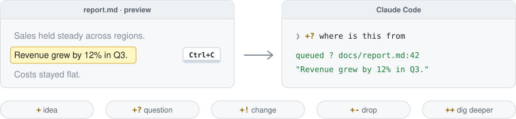
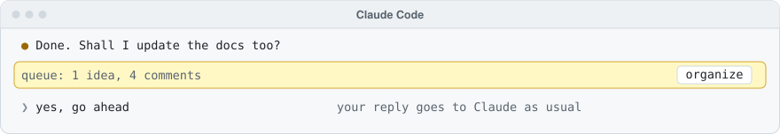
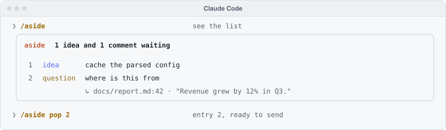

# aside

<kbd>aside</kbd> is a prompt queue for <kbd>Claude Code</kbd>. Queue prompts, ideas and comments while Claude works, without interrupting it, and send them once it finishes or whenever you are ready.

<p>
  <a href="https://github.com/gravityXX/aside/actions/workflows/ci.yml"></a>
  
  <a href="LICENSE"></a>
</p>

<picture>
  <source media="(prefers-color-scheme: dark)" srcset="assets/how-it-works-dark.svg">
  
</picture>

## How it works

### 1. Note it while Claude works

**To comment on something, copy it first** (<kbd>Ctrl</kbd>+<kbd>C</kbd> or <kbd>&#x2318;</kbd>+<kbd>C</kbd>), from anywhere: <kbd>VS Code</kbd>, a <kbd>terminal</kbd>, a <kbd>web page</kbd>. Then start a message with `+`, or end one with it. It goes to the queue, not to Claude. **No paste needed:** <kbd>aside</kbd> takes whatever is on your clipboard.

<picture>
  <source media="(prefers-color-scheme: dark)" srcset="assets/step-1-dark.svg">
  
</picture>

> [!NOTE]
> What you type in a hurry is tidied as it is queued: spelling, punctuation, wording. What you copied stays exactly as copied. To keep entries as typed, set `tidy` to `off` in `/config`. The other settings are under [More](#more).

### 2. Answer Claude as usual

Your reply goes to Claude. By default the queue just waits, in a line above the prompt. Its <kbd>list</kbd> button opens the entries, with <kbd>plan</kbd> to organize them.

<picture>
  <source media="(prefers-color-scheme: dark)" srcset="assets/step-2-dark.svg">
  
</picture>

### 3. Plan or run when ready

Nothing reaches Claude until you say so: look at the list, then plan, run or pop.

<picture>
  <source media="(prefers-color-scheme: dark)" srcset="assets/step-3-dark.svg">
  
</picture>

## Install

```text
/plugin marketplace add gravityXX/aside
/plugin install aside@aside
```

Requires <kbd>Claude Code</kbd> 2.1.301 or newer. The plugin API <kbd>aside</kbd> builds on is in early access and may change between releases.

## Commands

<table>
  <tr>
    <th colspan="2">Queue</th>
    <th colspan="2">Entries</th>
  </tr>
  <tr>
    <td><code>/aside</code></td><td>Show the queue and the plan; while Claude works, in the pane</td>
    <td><code>/aside pop [N]</code></td><td>Put the newest one (or N) in the box</td>
  </tr>
  <tr>
    <td><code>/aside plan</code></td><td>Turn the queue into steps, merged with the steps still to do; what Claude finds unclear stays in the queue</td>
    <td><code>/aside edit N</code></td><td>Rework one and queue it again</td>
  </tr>
  <tr>
    <td><code>/aside run [N ...]</code></td><td>Run the steps in turn (Claude can pause to ask you, and sums the run up after the last one), or only N ...: steps of the plan, or entries once no step is left to do</td>
    <td><code>/aside move N M</code></td><td>Move N to place M</td>
  </tr>
  <tr>
    <td><code>/aside run all</code></td><td>Send the queue as is, no plan</td>
    <td><code>/aside remove N [M ...]</code></td><td>Remove one, or several at once</td>
  </tr>
  <tr>
    <td><code>/aside stop</code></td><td>Stop after the current step</td>
    <td><code>/aside clear</code></td><td>Empty the queue</td>
  </tr>
  <tr>
    <td><code>/aside help</code></td><td>List every command</td>
    <td><code>/aside undo</code></td><td>Bring back what plan, run or clear took</td>
  </tr>
</table>

`N` is a number as `/aside` shows it; in brackets, `[N]`, you can leave it out. Tab completes every command.

## More

> [!IMPORTANT]
> **The queue stays on your machine**, one per project. Nothing reaches Claude's conversation until you run `/aside plan` or `/aside run`, or `afterClaudeAnswers` does. With `tidy` on, the text you type goes to Haiku to be corrected. What you copied never does.

<details>
<summary>Other ways to comment</summary>

<br>

| You type or do | It queues |
| --- | --- |
| `why is this so slow +?` | the whole draft, as `+? why is this so slow` |
| `+? why did this fail`, nothing copied | the question with the last tool output, an error first |
| `+? @docs/report.md:42 why this order` | a question about line 42 of that file |
| `+! @report.md#results shorter` | a change for the Results heading |
| `+- #appendix` | a drop for an Appendix heading in a file written this session |
| `<!-- ? why -->` in a markdown file | a question, and `!` a change, `-` a drop, `+` dig deeper |
| select lines of Claude's reply | the selected lines, when nothing new is copied (fullscreen mode) |

Tags count in markdown files Claude wrote or edited this session. `/aside scan FILE` adds any other file.

</details>

<details>
<summary>Settings</summary>

<br>

Change these in `/config`:

| Setting | Default | Or | What it does |
| --- | --- | --- | --- |
| `afterClaudeAnswers` | `wait` | `plan`, `run all` | Once Claude answers: wait for you, or plan or run all by itself |
| `order` | `oldest` | `newest` | Which entry comes first in the list and in a run |
| `tidy` | `on` | `off` | Fix the spelling and wording of what you type |

The clipboard is read with `powershell` on WSL and Windows, `pbpaste` on macOS, and `wl-paste`, `xclip` or `xsel` on Linux, only for a comment that names no line or heading.

</details>

<br>

<p><sub><a href="LICENSE">LICENSE</a> &#xB7; <a href="CHANGELOG.md">CHANGELOG</a> &#xB7; <a href="CONTRIBUTING.md">CONTRIBUTING</a></sub></p>
