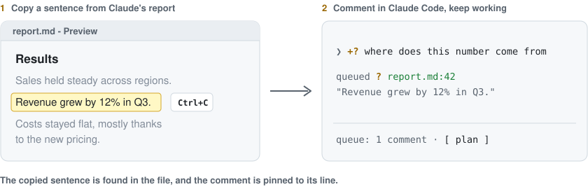

<picture>
  <source media="(prefers-color-scheme: dark)" srcset="assets/banner-dark.svg">
  
</picture>

<p>
  <a href="https://github.com/gravityXX/idea-queue/actions/workflows/ci.yml"></a>
  
  
  
</p>

Claude is in the middle of a task. You are reading the report it just wrote, and you have a question about one number, a section you would drop, an idea for later. Interrupting would derail it. Typing it all out later means finding every spot again.

With idea-queue you copy the sentence, type your comment and go on reading. Claude never sees it until you say so.

## Comment on what Claude wrote

<picture>
  <source media="(prefers-color-scheme: dark)" srcset="assets/comment-flow-dark.svg">
  
</picture>

1. Select a sentence in the preview of any markdown file and press `Ctrl+C`.
2. In Claude Code, type a mark and your comment, and press Enter.
3. That is all. idea-queue finds the copied sentence in the file and pins your comment to its line, with the quote.

| Mark | Means     | Example                               |
| ---- | --------- | ------------------------------------- |
| `+?` | question  | `+? where does this number come from` |
| `+!` | change    | `+! make this a table`                |
| `+-` | drop      | `+- drop this section`                |
| `++` | go deeper | `++ compare with last year`           |

No need to edit the file, open it in an editor or say where you were. The preview can stay a preview.

## Then Claude gets it all at once

When the task is done, `/queue plan` hands everything over, grouped by file, each comment with its line and the sentence it is about:

```text
docs/report.md:
  1. [question] line 42, on "Revenue grew by 12% in Q3.": where does this number come from
  2. [change] line 57, on "Costs by region": make this a table
  3. [drop] line 80, on "Appendix: raw data": drop this section
```

Claude answers the questions straight away, merges what belongs together and writes one prompt per step. `/queue run` then runs the steps one by one, each when the one before has finished.

> [!TIP]
> Just a few small things? `/queue run all` sends everything in one message, to be done at once.

## Park an idea

Not about a document, just a thought for later? Start the message with `+`. It goes into the queue instead of to Claude, even mid-task, and the prompt box is ready for the next one.

```text
+ rename the config loader
+ cache the parsed config
```

## Install

```text
/plugin marketplace add gravityXX/idea-queue
/plugin install idea-queue@idea-queue
```

> [!NOTE]
> Needs Claude Code 2.1.301 or newer. The plugin API it builds on is in early access and may change between releases.

## Commands

| Command          | What it does                                   |
| ---------------- | ---------------------------------------------- |
| `/queue`         | Show the queue and the plan                    |
| `/queue plan`    | Turn the queue into steps                      |
| `/queue run`     | Run the steps, or the entries, in order        |
| `/queue stop`    | Stop after the current step                    |
| `/queue pop [N]` | Put an entry in the prompt box, ready to send  |
| `/queue edit N`  | Rework an entry and queue it again             |
| `/queue clear`   | Empty the queue (`/queue undo` brings it back) |

`/queue help` lists every command; Tab completes them.

<details>
<summary>More ways to comment</summary>

Name the place yourself, right after the mark:

```text
+? @docs/report.md:42 why this order
+! @report.md#results shorter
+- #appendix
```

On Claude's own reply in the terminal, select the lines with the mouse (fullscreen mode) instead of copying. With nothing copied, a comment takes the last command output, so `+? why did this fail` arrives with its error.

In an editor, tags in a markdown file count too: `<!-- ? question -->`, `<!-- ! change -->`, `<!-- - drop -->`, `<!-- + go deeper -->`.

</details>

<details>
<summary>Settings, platforms and privacy</summary>

`/config` has one setting, `whenTurnEnds`: what happens to the queue when Claude finishes a turn. `wait` (default) keeps it until you run `/queue plan` or `/queue run`, `plan` turns it into a plan at once, `send` sends it to be done at once.

The clipboard is read with `powershell.exe` on WSL, `pbpaste` on macOS, `wl-paste`, `xclip` or `xsel` on Linux and `powershell` on Windows. It is read only for a comment that names no place, never for a plain `+` idea.

The queue stays on your machine, one per project. Nothing reaches Claude until you run `/queue plan` or `/queue run`.

</details>

## License

Apache 2.0, see [LICENSE](LICENSE).
